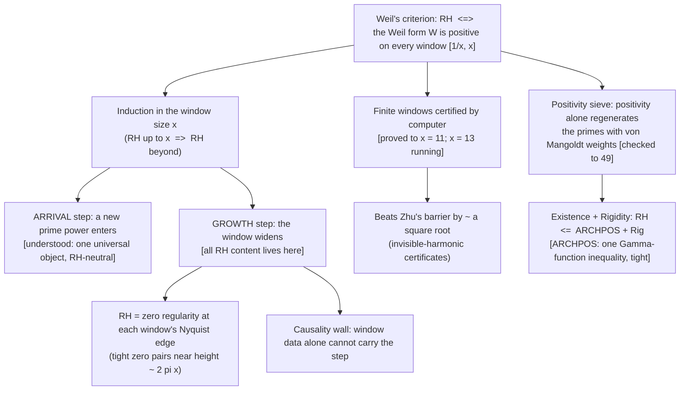

# RH Open Map

**An organized, open map of one sustained attack on the Riemann Hypothesis: what was built, what was proved, what was only checked, what failed and why, and the sharply posed open problems that remain.**

> **Status: the Riemann Hypothesis is open. Nothing here proves it.** This repository is a map, not a proof. Every claim carries a label:
> **[proved]** (a complete argument is given), **[proved, computer-assisted]** (a certified interval-arithmetic computation), **[checked]** (numerical evidence, not a proof),
> **[heuristic]**, or **[conjecture]**. Results marked *awaiting independent verification* have not yet been re-checked by an independent party.

The goal is to make the problem **decentralized**: to let anyone pick up a precisely stated piece, with code and data, and either finish it or kill it.

---

## The map at a glance

## Headline results

| Result | Status | Where |
|---|---|---|
| Weil positivity certified on every window up to **x = 11** (supp g in [-log 11, log 11]); previous published record x = 4.953 (Zhu) | [proved, computer-assisted] *awaiting independent verification* | [results/01](results/01-window-certificates.md) |
| **Invisible-harmonic certificates**: a certificate class outside Zhu's barrier theorem, cutting the required frequency cutoff from 2 pi e^{A_x} to about 2 pi e^{A_x/2} (x = 11: 800 instead of ~13,000) | [proved] method; [proved, computer-assisted] runs | [results/01](results/01-window-certificates.md) |
| Krein duality: the best possible version of this certificate equals a compressed prime-operator norm Lambda_x ~ 1.1 sqrt(x), matching the detection limit of off-line zeros ~ e^{sqrt x} | [proved] identification; [checked] values | [results/01](results/01-window-certificates.md) |
| **Positivity sieve**: Weil positivity + Gamma factor + pole alone re-derive every prime power 2..49 with weight Lambda(n)/sqrt(n) and reject all composites | [checked] | [results/02](results/02-positivity-sieve.md) |
| **Arrival of each prime power = one universal family** of odd edge modes, counted by a single layer coordinate | [checked], out of sample to n = 19 | [results/03](results/03-arrival-universal-family.md) |
| Near-null spectrum of every window = Connes-Consani prolate ladder; universal arrival law derived with no fitted profile | [checked] / [proved] parts | [results/04](results/04-near-null-ladder.md) |
| Where RH lives: an O(1) angle per window, eaten by tight zero pairs at the window's horizon; the prime phases conspire pointwise thousands of times but never at the window's resolution | [checked] | [results/05](results/05-where-rh-lives.md) |
| RH <= ARCHPOS + Rig, with ARCHPOS a single inequality on the Gamma function and the pole; ARCHPOS shown numerically to be tight | [proved] chain; [checked] tightness | [results/06](results/06-existence-rigidity.md) |

## How to contribute

1. Pick an open problem from [open-problems/](open-problems/README.md). Each has a statement, what is known, entry points, and what success means.
2. Read the matching results page and the [graveyard](GRAVEYARD.md) (routes that are known to fail, and why), so you do not repeat them.
3. Reproduce with [code/](code/README.md). Certificates use python-flint (Arb ball arithmetic); experiments use numpy/scipy/mpmath.
4. Report with labels ([proved]/[checked]/[heuristic]/[conjecture]). Negative results are welcome: a clean kill of a route is progress. See [CONTRIBUTING.md](CONTRIBUTING.md).

## Contents

- [MAP.md](MAP.md): the full organized map with the status of every component.
- [results/](results/): one page per body of results.
- [open-problems/](open-problems/README.md): the problems we could not finish, posed for others.
- [GRAVEYARD.md](GRAVEYARD.md): failed routes, one line each, with the reason.
- [code/](code/README.md) and [data/](data/): scripts and certificate outputs.
- [CREDITS.md](CREDITS.md): prior work this builds on, rediscoveries, and AI assistance.

## Authorship

Roger Malcolm III, with AI research assistance (a team of Claude agents: Fable 5.1 and Opus 5.5). The agent team worked as independent explorers with one verifier; see [CREDITS.md](CREDITS.md).
License: code under MIT (LICENSE), text under CC BY 4.0 (LICENSE-TEXT.md).
